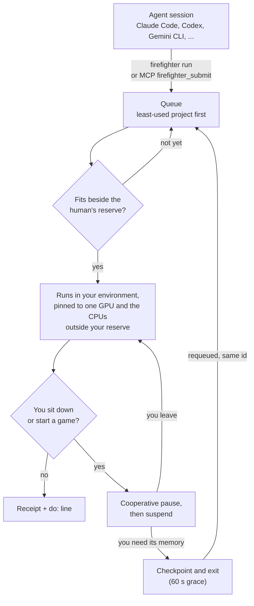

<p align="center"></p>

<p align="center">
  <a href="https://github.com/JoshWright22/FIREFIGHTER/actions/workflows/ci.yml"></a>
  <a href="https://github.com/JoshWright22/FIREFIGHTER/releases"></a>
  
  
  <a href="LICENSE"></a>
</p>

<h3 align="center">Your AI agents won't set your GPU on fire. Or your CPU, your RAM, or your network.</h3>

<p align="center"><b>FIREFIGHTER</b> is the coordinator and scheduler for unmanaged AI agents: a local job queue and
market maker that shares one computer's GPU, CPU, RAM and network among AI coding agents
(<b>Claude Code, Codex, Gemini CLI, Cursor, Grok, OpenCode, Kimi, Antigravity, Copilot, T3 Code</b> and more).<br>
One command to install, on <b>Windows, macOS and Linux</b>.</p>

<p align="center"></p>

## Why

Run three or four agents at once and each one decides on its own to train a model, run an eval
sweep, build a Docker image or render something. They all grab the same GPU. VRAM runs out, two
trainings slow each other to a crawl, your game stutters, audio crackles, and nobody knows who's
using what. FIREFIGHTER gives every agent one queue where it sees what the others are doing, keeps
a reserve of the machine for you, and moves their work out of the way when you sit down.

## Install (one command)

**Windows** (PowerShell):

```powershell
irm https://raw.githubusercontent.com/JoshWright22/FIREFIGHTER/main/scripts/install.ps1 | iex
```

**macOS / Linux**:

```sh
curl -fsSL https://raw.githubusercontent.com/JoshWright22/FIREFIGHTER/main/scripts/install.sh | sh
```

**Go 1.23+**:

```sh
go install github.com/JoshWright22/firefighter/cmd/firefighter@latest && firefighter setup
```

The installer checks the release checksum, puts one ~8 MB binary on your PATH and runs
`firefighter setup`. No admin rights. Check it with `firefighter status`; remove it with
`firefighter uninstall`. Requirements and every file it touches: [docs/reference.md](docs/reference.md#install-details).

## How it works



1. An agent sends heavy work through `firefighter run` (or the `firefighter_submit` MCP tool) with a
   time estimate. It waits in a queue where the project that has used the least goes first.
2. A job starts only when its CPU, RAM and VRAM need (learned from past runs) fits next to the
   reserve FIREFIGHTER keeps for you. GPU jobs are pinned to the card they were admitted on.
3. When you start typing, open a fullscreen app or start a game, your reserve grows within half a
   second. Jobs are paused, then suspended, and if you need their memory they checkpoint and go
   back in line on their own.
4. Every reply ends with one market line and a `do:` with the recommended next step.

**What an agent sees** (`firefighter run`, your program's output passes through unchanged):

```text
$ firefighter run --gpu --minutes 40 --vram 10 --name "nanoGPT train" -- python train.py
◆ 3f2a91c0 nanoGPT train waiting #2, starts ~2:05 PM (in 22m): GPU turn queue
   gpu 40m: start ~22m, cost ~42 of 212 (urgent ~6m ~84) (spot ~70m ~14) | busy 15/60/120m 92/35/12% | quiet 02:00 (usually 8% busy) | do: queue it at normal (starts ~22m); keep working meanwhile
◆ nanoGPT train: spotlight's yours (lease 40 min, budget left 212.0)
step 1200 | loss 2.913 ...
◆ nanoGPT train: FIREFIGHTER needs it to stop (VRAM below the human's 8.0 GB reserve); it gets time to save and exit, then it's requeued
◆ stopped to give the human the machine back; back in line automatically (attempt 2). Nothing to do: it restarts when there's room
◆ nanoGPT train: spotlight's yours (lease 40 min, budget left 180.6)
◆ nanoGPT train: curtain call, ok (exit 0) in 21.4 min (declared 40), waited 6.1, charged 18.2 machine-min, peak 3.1 GB RAM / 9.4 GB VRAM
```

**What you see** (`firefighter status`, while you play a game):

```text
$ firefighter status
FIREFIGHTER  human: on stage (game/media) eldenring.exe using 64% of the 3D engine
  reserve for the human: 6 CPUs, 35% RAM, 8.0 GB VRAM
  CPU 9.2/16 busy (5.1 human+other)  RAM 18.4/63.9 GB free  GPU 71%  VRAM 14.9/24.0 GB
  policy: preset balanced, order las, pricing priced, budget karma
  gpu 30m: start ~1.5h, cost ~38 of 168 (spot ~2.1h ~13) | busy 15/60/120m 95/70/31% | quiet 02:00 (usually 8% busy) | do: queue it (starts ~1.5h), or spot if it can wait, or plan it for 02:00

on stage
  3f2a91c0 nanoGPT train                      nanoGPT        until ~2:45 PM paused: the human needs the GPU (eldenring.exe using 64% of the 3D engine)

in the wings
  a81c0d42 #1 eval sweep                      evals          on ~3:20 PM the human needs the GPU (eldenring.exe using 64% of the 3D engine)
  77d0e5b1 #2 docs build                      site           on ~2:31 PM needs 6.0 GB RAM, 4.2 GB free after the human's reserve

budgets (machine-minutes left)
  nanoGPT                  180.6
  evals                    168.5
  site                     240.0
```

The full mechanics (the decision table, the preemption ladder, the market math) are in
[docs/how-it-works.md](docs/how-it-works.md).

## What you get

- **You come first.** A reserve of CPUs, RAM and VRAM that follows your keyboard, fullscreen apps,
  games, Docker and your own programs.
- **Turns instead of fights.** One queue, fair share by project, a 45-minute cap on any wait, and
  VRAM admission learned from each command's past runs.
- **Posted prices, no bidding war.** Spot (1/3 price), normal and urgent (2x) tiers against a daily
  budget, summed up in one ~60-token line per reply.
- **Polite preemption.** CPU set, then pause, suspend, checkpoint and requeue. Kill only when RAM
  is critical.
- **Agents that skip the queue are caught.** Heavy work started outside FIREFIGHTER is adopted,
  billed 1.5x and preempted first.
- **Network too.** Downloads and installs take turns and wait while you're on a call or gaming.
- **Any machine.** Any number of NVIDIA, AMD or Intel GPUs, any CPU count, Windows, macOS and
  Linux. Each PC runs on its own; nothing goes over the network.
- **Set and forget.** Starts at logon and teaches every agent it finds the protocol.

## Agents it sets up

Claude Code, Codex, Gemini CLI, Antigravity, Cursor, Grok Build, OpenCode, Kimi CLI and Kimi Code,
Pi, Muse Code, fx, Kiro, Windsurf/Devin, Copilot CLI, Amp, Qwen Code, Crush, Cline, Goose and Droid
(and apps built on them, like T3 Code), each with its MCP server entry and a short rule block.

## CLI cheat sheet

```sh
firefighter run --gpu --minutes 40 --vram 10 --name "nanoGPT train" -- python train.py
firefighter run --gpu --urgent --minutes 10 -- python eval.py     # you're waiting on it: 2x
firefighter run --gpu --spot --minutes 120 -- python sweep.py     # can wait: 1/3 price
firefighter run --detach --gpu --minutes 90 -- python sweep.py    # prints an id; then: firefighter wait <id>
firefighter quote --gpu --minutes 30 --vram 8                     # the market, no side effects
firefighter status                                                # the human, the queue, budgets
firefighter extend <id> 15                                        # running long? say so
firefighter plan "eval sweep" --when tonight --minutes 120 --gpu 90 --vram 12
firefighter config set preset gamer                               # balanced, gamer, throughput, fair
firefighter protocol                                              # pause/checkpoint helper for GPU loops
```

MCP tools: `firefighter_submit`, `firefighter_wait`, `firefighter_status`, `firefighter_job`,
`firefighter_plan`. Every command and flag: [docs/reference.md](docs/reference.md#cli-reference).

## Docs

- [How it works](docs/how-it-works.md): features in detail, the decision table and presets, the preemption ladder, the research behind each number
- [Reference](docs/reference.md): install details, CLI, files, per-OS support, comparison with other tools, FAQ, testing
- [Security notes](docs/security.md): what the guard trusts and what it doesn't
- [Integrations](docs/integrations.md): status line, event stream, HTTP API, Claude Code plugin, VS Code extension
- [Research report](docs/research.md): the original survey of repos and papers, with sources

<p align="center"><br><sub>MIT · built for people who run too many agents at once</sub></p>
