<p align="center"></p>

<p align="center">
  <a href="https://github.com/JoshWright22/FIREFIGHTER/actions/workflows/ci.yml"></a>
  <a href="https://github.com/JoshWright22/FIREFIGHTER/releases"></a>
  
  
  <a href="LICENSE"></a>
</p>

<h3 align="center">Your AI agents won't set your GPU on fire. Or your CPU, your RAM, or your network.</h3>

<p align="center"><b>FIREFIGHTER</b> is the coordinator and scheduler for unmanaged AI agents: a local job queue and
market maker that shares one computer's GPU, CPU, RAM and network among AI coding agents
(<b>Claude Code, Codex, Gemini CLI, Cursor, Grok, OpenCode, Kimi, Antigravity, Copilot, T3 Code</b> and more).<br>
One command to install, on <b>Windows, macOS and Linux</b>.</p>

<p align="center"></p>

## Why

Run three or four agents at once and each one decides on its own to train a model, run an eval
sweep, build a Docker image or render something. They all grab the same GPU. VRAM runs out, two
trainings slow each other to a crawl, your game stutters, audio crackles, and nobody knows who's
using what. FIREFIGHTER gives every agent one queue where it sees what the others are doing, keeps
a reserve of the machine for you, and moves their work out of the way when you sit down.

## Install (one command)

**Windows** (PowerShell):

```powershell
irm https://raw.githubusercontent.com/JoshWright22/FIREFIGHTER/main/scripts/install.ps1 | iex
```

**macOS / Linux**:

```sh
curl -fsSL https://raw.githubusercontent.com/JoshWright22/FIREFIGHTER/main/scripts/install.sh | sh
```

**Go 1.25+** (with Go's bin directory on your PATH):

```sh
go install github.com/JoshWright22/firefighter/cmd/firefighter@latest && firefighter setup
```

The release installers check the checksum, install the binary and run `firefighter setup` without
admin rights. On macOS and Linux, open a new shell to pick up any PATH change. Builds from `go install`
report version `dev` and don't update themselves.

Check it with `firefighter status`. `firefighter uninstall` removes autostart, MCP entries and agent
rules, and stops the guard. It leaves the binary, any PATH entry and the state folder. Delete the
binary, remove the PATH entry if you don't need it, and delete the state folder if you want to forget
settings and history. See [install details](docs/reference.md#install-details) for the locations.

## How it works

1. An agent sends heavy work through `firefighter run` (or the `firefighter_submit` MCP tool) with a
   time estimate. By default, projects that have used less go first within each priority band, with
   bids adjusting their order.
2. A job starts when the scheduler sees room beside your reserve. It uses declarations and past
   runs, and can clamp the RAM or VRAM need it counts for admission. On multi-GPU machines it selects
   a card and sets device visibility for supported runtimes unless you already chose devices.
3. The reserve reacts quickly to keyboard activity and detected games. Fullscreen and 3D-engine
   detection are Windows-only; on macOS and Linux, list games in `reserve.exclusive_apps`. The guard
   can ask jobs to pause, suspend them, or ask them to save and exit. Jobs that checkpoint and exit
   with code 75 go back in line automatically.
4. Most agent replies include a market line or a `do:` with the recommended next step.

**What an agent sees** (selected `firefighter run` output, including your program's own output):

```text
$ firefighter run --gpu --minutes 40 --vram 10 --name "nanoGPT train" -- python train.py
◆ 3f2a91c0 nanoGPT train waiting #2, starts ~2:05 PM (in 22m): GPU turn queue
   gpu 40m: start ~22m, cost ~42 of 212 (urgent ~6m ~84) (spot ~22m ~14) | busy 15/60/120m 79/35/12% | quiet 02:00 (usually 8% busy) | do: queue it at normal (starts ~22m); keep working meanwhile
◆ nanoGPT train: spotlight's yours (lease 40 min, budget left 212.0)
step 1200 | loss 2.913 ...
◆ nanoGPT train: FIREFIGHTER needs it to stop (VRAM below the human's 8.0 GB reserve); it gets time to save and exit, then it's requeued
◆ nanoGPT train: curtain call, evicted (exit 75) in 12.0 min (declared 40), waited 22.0, charged 31.4 machine-min, peak 3.1 GB RAM / 9.4 GB VRAM
◆ stopped to give the human the machine back; back in line automatically (attempt 2). Nothing to do: it restarts when there's room
...
◆ nanoGPT train: spotlight's yours (lease 40 min, budget left 180.6)
◆ nanoGPT train: curtain call, ok (exit 0) in 21.4 min (declared 40), waited 6.1, charged 18.2 machine-min, peak 3.1 GB RAM / 9.4 GB VRAM
```

**What you see** (selected `firefighter status` output while you play a game):

```text
$ firefighter status
FIREFIGHTER  human: on stage (game/media) eldenring.exe using 64% of the 3D engine
  reserve for the human: 6 CPUs, 35% RAM, 8.0 GB VRAM
  CPU 9.2/16 busy (5.1 human+other)  RAM 24.0/63.9 GB free  GPU 71%  VRAM 14.9/24.0 GB
  policy: preset balanced, order las, pricing priced, budget karma
  gpu 30m: start ~1.5h, cost ~120 of 168 (spot ~2.1h ~40) | busy 15/60/120m 96/92/64% | quiet 02:00 (usually 8% busy) | do: queue it (starts ~1.5h), or spot if it can wait, or plan it for 02:00
  cpu 30m: start ~1m, cost ~4 of 168 (spot ~1m ~1) | busy 15/60/120m 12/20/25% | do: queue it at normal (starts ~1m); keep working meanwhile

on stage
  3f2a91c0 nanoGPT train                      nanoGPT        until ~2:45 PM paused: the human needs the GPU (eldenring.exe using 64% of the 3D engine)

in the wings
  a81c0d42 #1 eval sweep                      evals          on unknown the human needs the GPU (eldenring.exe using 64% of the 3D engine)
  77d0e5b1 #1 docs build                      site           on unknown needs 6.0 GB RAM, 1.6 GB free after the human's reserve (it starts with 3.2 GB to spare)

budgets (machine-minutes left)
  default                  168.0
  nanoGPT                  180.6
  evals                    168.5
  site                     240.0
```

The full mechanics (the decision table, the preemption ladder, the market math) are in
[docs/how-it-works.md](docs/how-it-works.md).

## What you get

- **You come first.** A CPU, RAM and VRAM reserve that responds to your activity and accounts for
  other programs, including Docker.
- **Turns instead of fights.** One queue with priority bands and fair share by project. After 45
  minutes by default, a waiting job moves ahead of newer jobs in its band. It still waits for room
  and gives way to games.
- **Posted prices, no bidding war.** By default, spot pays one third of the normal rate and urgent
  pays twice the normal rate. Quotes show prices and the project's budget.
- **It keeps itself current.** A released guard installs newer releases by itself, checked against
  the release's checksums (and signed build provenance when available and the GitHub CLI is signed
  in). It downloads in the background and restarts as the new version only when no job is running. Set `update.auto = false` to turn this off.
- **It learns from its runs.** Measured runs tell it what a command needs (RAM, VRAM,
  CPUs, GPU load, disk, network), and your own use teaches it how much to keep free for you.
  `firefighter forecast` shows what it expects.
- **RAM and disk reserves.** On Windows, the guard can reclaim the WSL/Docker VM's file cache first
  (`reserve.reclaim_vm_cache`) and trim suspended jobs' memory. It keeps free space on your drives too.
- **Preemption.** The guard can limit CPU use, pause or suspend jobs, and request a checkpoint.
  It can stop jobs under critical RAM or sustained VRAM pressure. `--evict force` skips the checkpoint grace.
- **Outside work can be adopted.** Processes descended from known agent CLIs (`guard.agent_parents`)
  that stay heavy outside the queue can be adopted, billed at 1.5x and preempted first.
- **Network too.** Network-heavy jobs take turns. By default they give way to games and can wait
  when your own traffic is using much of the link.
- **Disk space you hand out.** Give agents a folder and a size (`storage.gb`). Each project claims
  a space in it, ranks what it saves (keep, useful, scratch) and says what each thing is for, and
  frees the least important first. Nothing ranked keep is deleted by `storage free`, and a project
  over its claim starts no new jobs, including `--quick`, until it frees space or increases its claim.
- **Honest waiting.** A waiting job's line says what it waits for, with the numbers, and its start
  time is "unknown" when nothing can forecast it. `firefighter amend` fixes a waiting job's
  declarations without resetting its wait.
- **Containers count.** The guard tracks memory for Docker containers tied to a job and can cap it
  when the job declares `--ram` or the container has a memory limit. `run --quick` covers a short
  look inside an image.
- **Optional idle-GPU harvester.** Salad, BOINC or similar can run after the GPU has been idle for
  the configured delay. The electricity-cost check applies only when `[harvester.profit]`
  `cents_per_kwh` is positive. See `firefighter harvest`.
- **Local scheduling.** Runs on Windows, macOS and Linux, with GPU support that varies by platform.
  The guard schedules locally; release updates use the network.
- **Logon setup.** Sets up supported agent integrations and configures the guard to start at logon.
  On Linux it uses a user systemd service when available, or XDG autostart on desktops that honor it.

## Agents it sets up

Claude Code, Codex, Gemini CLI, Antigravity, Cursor, Grok Build, OpenCode, Kimi CLI and Kimi Code,
Pi, Muse Code, fx, Kiro, Windsurf/Devin, Copilot CLI, Amp, Qwen Code, Crush, Cline, Goose and Droid
(and apps built on them, like T3 Code). Each gets what it supports: an MCP server entry, a short
rule block in its global instructions, or both.

## CLI cheat sheet

```sh
firefighter run --gpu --minutes 40 --vram 10 --name "nanoGPT train" -- python train.py
firefighter run --gpu --urgent --minutes 10 -- python eval.py     # you're waiting on it: 2x by default
firefighter run --gpu --spot --minutes 120 -- python sweep.py     # can wait: 1/3 price by default
firefighter run --detach --gpu --minutes 90 -- python sweep.py    # prints an id; then: firefighter wait <id>
firefighter quote --gpu --minutes 30 --vram 8                     # prices only, queues nothing
firefighter status                                                # the human, the queue, budgets
firefighter extend <id> 15                                        # running long? say so
firefighter amend <id> --vram 8                                   # fix a waiting job's estimate without resetting its wait
firefighter run --quick -- docker run --rm img ls /data           # a short look inside an image
firefighter plan "eval sweep" --when 22:00 --minutes 120 --gpu 90 --vram 12
firefighter storage claim --gb 20 --why "datasets"                # a disk space of your own (the human allots it)
firefighter storage label data/raw --rank useful --for "training set, 2 h to download"
firefighter storage free --gb 5                                   # delete scratch first; keep never goes
firefighter harvest                                               # the idle-GPU harvester's books
firefighter config set preset gamer                               # balanced, gamer, throughput, fair
firefighter protocol                                              # pause/checkpoint helper for GPU loops
```

Six MCP tools by default: `firefighter_submit`, `firefighter_wait`, `firefighter_status`,
`firefighter_job`, `firefighter_plan`, `firefighter_storage`. `firefighter_config` is available only
when `guard.agents_can_configure` is true. See the [CLI reference](docs/reference.md#cli-reference).

## Docs

- [How it works](docs/how-it-works.md): features in detail, the decision table and presets, the preemption ladder, the research behind each number
- [Reference](docs/reference.md): install details, CLI, files, per-OS support, comparison with other tools, FAQ, testing
- [Security notes](docs/security.md): what the guard trusts and what it doesn't
- [Integrations](docs/integrations.md): status line, event stream, HTTP API, Claude Code plugin, VS Code extension
- [Research report](docs/research.md): the original survey of repos and papers, with sources

<p align="center"><br><sub>MIT · built for people who run too many agents at once</sub></p>
