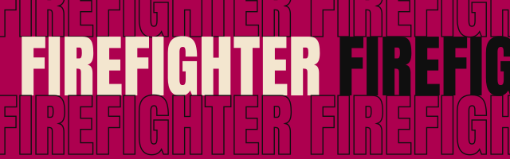

<p align="center"></p>

<p align="center">
  <a href="https://github.com/JoshWright22/FIREFIGHTER/actions/workflows/ci.yml"></a>
  <a href="https://github.com/JoshWright22/FIREFIGHTER/releases"></a>
  
  
  <a href="LICENSE"></a>
</p>

<h3 align="center">Your AI agents won't set your GPU on fire. Or your CPU, or your RAM.</h3>

<p align="center"><b>firefighter</b> is a local GPU, CPU and RAM scheduler, job queue and market maker for AI coding agents
(<b>Claude Code, Codex, Gemini CLI, Cursor, Grok, OpenCode, Kimi, Antigravity, Copilot, T3 Code</b> and more) that share one computer.<br>
One command to install, on <b>Windows, macOS and Linux</b>. After that, every agent session queues its heavy work, sees
what the others are doing, and gets out of the way when you need the machine.</p>

<p align="center"></p>

---

## The problem

Run three or four agents at once and each one decides on its own to train a model, run an eval
sweep, build a Docker image or render something. They all grab the same GPU. VRAM runs out (CUDA
out-of-memory, or silent spill into system RAM on Windows), two trainings slow each other to a
crawl, your game stutters, audio crackles, and nobody knows who's using what or for how long.

## What firefighter does

- 🎤 **You always come first.** It watches your keyboard and mouse, fullscreen apps, games (3D-engine
  use), and every process it didn't start: Docker containers, Kubernetes pods, local model servers,
  your own apps. It keeps a **dynamic reserve** of CPUs, RAM and VRAM for you that grows within half a
  second when you sit down or start a game and gives capacity back slowly when you leave.
- 🎟️ **Agents take turns instead of fighting.** Heavy work waits in a queue. A GPU job starts only
  when its VRAM need fits, and that need is learned from the command's past runs. Projects that have
  used the least go first (least attained service), with a 45-minute cap on any wait.
- 💹 **A market maker, not a bidding war.** Agents don't bid against each other. firefighter posts
  prices for three tiers: **spot** (leftovers, ⅓ price), **normal**, and **urgent** (2×, only
  when you're waiting on the result). Every reply an agent already gets ends with one line: when
  each tier would start, what it costs against the agent's budget, the odds the GPU is busy over
  the next 2 hours, a quiet hour to aim for, and a `do:` with the one recommended action. The
  advice never tells an agent to outbid anyone, so the whole market costs about 60 tokens and
  there's no bidding war to win.
- 🛡️ **Fallbacks for careless or rogue agents.** Heavy processes an agent starts outside firefighter
  are found and adopted anyway: idle priority, billed 1.5×, preempted first. That makes skipping
  the queue strictly worse than using it. Other guards cover queue flooding (per project and in
  total), new project names that try to get a fresh budget (all new projects share one small
  daily pool), chronic under-estimates (×1.25), VRAM hoarding (×3), lease overruns (×2, preempted
  first), leases over 24 h, extensions after a short backfill, and one agent cancelling or
  re-bidding another agent session's job (you, from a terminal or editor, can manage any job). Text an agent sends (plans, names) is stripped of control
  characters before other agents or your terminal see it.
- ⏸️ **Polite preemption.** The ladder goes: shrink the job's CPU set → cooperative pause at a step
  boundary → suspend (for jobs that ignore the pause) → checkpoint-and-exit with automatic requeue
  when you need the memory back → kill, but only when RAM is critical.
- 🧮 **Any machine.** Any number of GPUs from any vendor (NVIDIA, AMD, Intel; mixed is fine), any
  CPU count (Windows processor groups past 64 included), any RAM size. Each GPU job is placed on the
  card it was admitted on, in that vendor's own numbering. On mixed machines a job goes to the
  NVIDIA cards unless it says otherwise (`--gpu-vendor amd|intel|any`). Every PC runs its own firefighter; nothing
  goes over the network.
- 🔌 **Set and forget.** `setup` starts the guard at logon and, for every agent it finds installed,
  registers the MCP server and adds a short rule block to its global instructions, so every new
  session (including T3 Code threads) already knows the protocol: Claude Code, Codex, Gemini CLI,
  Antigravity, Cursor, Grok Build, OpenCode, Kimi CLI and Kimi Code, Pi, Muse Code, fx, Kiro,
  Windsurf/Devin, Copilot CLI, Amp, Qwen Code, Crush, Cline, Goose and Droid. Each in its own
  format; `uninstall` removes all of it.

## Install (one command)

**Windows** (PowerShell):

```powershell
irm https://raw.githubusercontent.com/JoshWright22/FIREFIGHTER/main/scripts/install.ps1 | iex
```

**macOS / Linux**:

```sh
curl -fsSL https://raw.githubusercontent.com/JoshWright22/FIREFIGHTER/main/scripts/install.sh | sh
```

The installer checks the release checksum, puts one ~8 MB binary on your PATH, and runs `firefighter setup`.
With Go 1.23+:
`go install github.com/JoshWright22/firefighter/cmd/firefighter@latest && firefighter setup`.

**Requirements:** Windows 10/11, macOS 12+ or Linux, on x64 or arm64. No admin rights needed. For
GPU numbers you need `nvidia-smi` (NVIDIA driver) or `rocm-smi` (AMD). On Linux, idle detection
uses GNOME, KDE or another freedesktop ScreenSaver desktop, or `xprintidle`; headless machines
count you as "present".

**What install changes** (each config file gets a one-time `*.firefighter.bak` backup first):

| What | Where |
|---|---|
| Binary | `%LOCALAPPDATA%\Programs\firefighter` (added to your user PATH) or `~/.local/bin` (added to your shell rc) |
| Autostart | Task Scheduler task `firefighter` (falls back to the HKCU Run key) · `~/Library/LaunchAgents/dev.firefighter.plist` · `~/.config/systemd/user/firefighter.service` (falls back to XDG autostart) |
| Agent rules | a marked block in `~/.claude/CLAUDE.md`, `~/.codex/AGENTS.md`, `~/.gemini/GEMINI.md` |
| MCP server | `claude mcp add` (or `~/.claude.json`), `~/.codex/config.toml`, `~/.gemini/settings.json`, `~/.cursor/mcp.json` |
| State | `%LOCALAPPDATA%\firefighter`, `~/Library/Application Support/firefighter`, `~/.local/state/firefighter` (or `FIREFIGHTER_HOME`) |

**Verify:** open a new terminal and run `firefighter status`. **Remove:** `firefighter uninstall` undoes
autostart, the rule blocks and the MCP entries. Then delete the binary and, if you want to forget
budgets and history, the state folder.

## Use

```sh
firefighter run --gpu --minutes 40 --vram 10 --name "nanoGPT train" -- python train.py
firefighter run --gpu --urgent --minutes 10 -- python eval.py          # you're waiting on it: 2x
firefighter run --gpu --spot --minutes 120 -- python sweep.py          # can wait: 1/3 price
firefighter run --minutes 5 -- npm run build                          # long CPU work
firefighter run --gpu --minutes 20 -- docker run --gpus all my/eval    # containers are governed too
id=$(firefighter run --detach --gpu --minutes 90 -- python sweep.py) && firefighter wait "$id"
firefighter quote --gpu --minutes 30 --vram 8                          # the market, no side effects
firefighter bid <id> 10                                                # make a waiting job urgent (5 = normal)
firefighter status                                                     # who's on stage until when, the queue, budgets
firefighter plan "eval sweep" --when tonight --minutes 120 --gpu 90 --vram 12
firefighter extend <id> 15                                             # running long? say so
```

`run` waits for a turn, then runs your command **in your own environment** (venv, conda, uv, nvm and
docker all just work), passes its output and exit code through, and ends with a receipt:

```
◆ 3f2a91c0 nanoGPT train waiting #2, starts ~14:05 (in 22m): GPU turn queue
   gpu 40m: start ~22m, cost ~42 of 212 (urgent ~6m ~84) (spot ~70m ~14) | busy 15/60/120m 92/35/12% | quiet 02:00 (usually 8% busy) | do: queue it at normal (starts ~22m); keep working meanwhile
◆ nanoGPT train: spotlight's yours (lease 40 min, budget left 212.0)
◆ nanoGPT train: curtain call, ok (exit 0) in 37.2 min (declared 40), waited 6.1, charged 31.4 machine-min, peak 3.1 GB RAM / 9.4 GB VRAM
```

**MCP tools** (one-line text replies plus `structuredContent`): `firefighter_submit`,
`firefighter_wait`, `firefighter_status` (which also gives quotes), `firefighter_job` (extend,
urgent/normal, cancel) and `firefighter_plan`. `firefighter_config` is listed only when you allow
agents to change the policy.

## How it decides (and how to change it)

Zero config gives you the researched defaults below. You can swap each part by name, live, with
`firefighter config set <key> <value>`. Agents can read the policy through the `firefighter_config`
MCP tool, and can change it only if you set `guard.agents_can_configure true`.

| Stage | Default | What it does | Swap with |
|---|---|---|---|
| **You** | dynamic reserve | Four states: away, present, active and game. The reserve grows within one 0.5 s tick and gives back 1 CPU every 15 s, RAM after 60 s and VRAM after 120 s. Jobs are pinned to the CPUs outside your reserve (Windows and Linux; macOS uses background QoS instead). A state with `pause_gpu` (game, by default) pauses GPU jobs and starts no new ones. | `reserve.<state>.cpus / ram_pct / vram_gb / pause_gpu`, `reserve.exclusive_apps` |
| **Order** | `las` | The project with the least use goes first, with a 12 h half-life (Tiresias, Slurm fair share). A 45-minute wait cap overrides it. | `order.policy = las \| stride \| lottery \| drf \| fifo \| srpt` |
| **Market** | `priced` | Price per machine-minute = tier (spot ⅓, normal 1, urgent 2) × congestion × 1.25 for projects whose jobs habitually overrun. Congestion is 0.5 × 8^u, where u is how committed the resource is over the next hour: 0.5 idle, about 1.4 at half load, 4 when full. The price is locked when the job is granted; overruns pay ×2 and adopted work ×1.5 on top. Urgent buys at most 30 min of queue lead under `las` and `stride`. | `pricing.policy = priced \| free`, `pricing.max_lead_minutes` |
| **Budget** | `karma` | Steady refill of 240 machine-minutes a day (10 an hour), banked up to 2 days (Karma, OSDI '23). The first project on a machine starts full. Later new projects start at the median usage and draw their start and first day's refill from one pool all new projects share (120 a day), so inventing names doesn't mint budget or jump the queue. While a project's budget is empty, its waiting and running jobs are spot. | `budget.policy = karma \| daily \| none`, `budget.daily_minutes`, `budget.bank_days`, `budget.projects.<name>`, `budget.weights.<name>` |
| **Charge** | DRF | One machine-minute is all of the GPU, VRAM, RAM or CPUs for one minute (Dominant Resource Fairness). Idle VRAM is charged ×3 (ESX idle tax), overruns ×2, and chronic under-estimates ×1.25. | built in |
| **Admission** | learned peaks | A job's need is the larger of its declared size and 1.2 × its learned peak, checked against what's left on the freest single GPU after your reserve and the unclaimed needs of jobs already there; a need is clamped to what that card ever offers (its size, less your reserve, less the least others have held lately). The job is pinned to that card (`CUDA_VISIBLE_DEVICES` with PCI order, `HIP_VISIBLE_DEVICES`/`ROCR_VISIBLE_DEVICES`, or the oneAPI selector; `docker run --gpus` is narrowed too). First-time commands start 5 s apart so their real use shows. Short jobs (≤ 10 min) may backfill behind a head that's waiting on VRAM. With no discrete GPU (Apple silicon), VRAM needs count as RAM. | `gpu.max_jobs`, `gpu.pack_below_util`, `gpu.vram_margin`, `gpu.default_vram_gb` |
| **Preemption** | ladder | See [the ladder](#the-preemption-ladder) below. | `ladder.*` |
| **Guard** | on | Heavy processes an agent CLI (Claude Code, Codex, Gemini, Grok, OpenCode, Kimi, Copilot, Amp, Qwen, Aider, Goose, Cline and more) starts outside firefighter get adopted: spot band, idle priority, charged. IDE terminals are never adopted. Each project is capped at 20 open jobs. Agents can read the policy but can't change it unless you allow it, and even then only `preset`, `order.*`, `pricing.*` and `gpu.*`. | `guard.auto_adopt`, `guard.agent_parents`, `guard.heavy_*`, `guard.agents_can_configure` |

**Presets:** `balanced` (default), `gamer`, `throughput`, `fair` → `firefighter config set preset gamer`.

| Band | Who | Preempted by |
|---|---|---|
| 0 · headliner | you, plus everything not run by firefighter (apps, games, Docker, k8s) | nothing |
| 1 · opener | short CPU jobs (≤ 3 min) | you |
| 2 · main set | in-budget GPU and long jobs (the market) | you |
| 3 · afterparty | over budget, `--spot`, past the lease, or adopted | anything |
| 4 · harvester | optional idle-GPU program (Salad, BOINC, Folding@home) | anything |

### The preemption ladder

Steps run in order, and each one fires only if the trigger is still there:

1. **CPU set.** Jobs always live outside your CPU reserve (Windows, Linux).
2. **Cooperative pause** (GPU jobs, while your state holds the GPU): firefighter creates the file
   at `FIREFIGHTER_PAUSE_FILE`. A job that honors it creates `FIREFIGHTER_PAUSED_FILE` and sleeps
   until the pause file is gone.
3. **Suspend:** if the job hasn't acknowledged within 10 s (or, where per-process GPU counters
   exist, acknowledged but kept computing), it's suspended. It stays suspended while you need the
   GPU. Past 60 s, if the memory it holds is what you're short of, it's stopped and requeued (it
   ignored the pause, so it can't checkpoint). `--evict never` jobs stay suspended until you're done.
4. **Checkpoint:** when RAM or VRAM (per card) stays under your reserve for 20 s, or when a spot job
   has run its 10-minute minimum and an in-budget job is waiting on what it holds, firefighter lifts
   any pause and creates `FIREFIGHTER_CHECKPOINT_FILE`. The job gets 60 s to save and exit. On Unix it then gets a
   SIGTERM, and 10 s later it's killed. A job that exits with 75, or exits at all after the
   request, is put back in line under the same id. `--evict force` jobs are killed at once.
5. **Kill:** if available RAM drops under 3%, one job is killed at once, even mid-grace, and the
   next only after 5 s (memory takes a moment to come back).

Victims are picked so one eviction fixes the problem: first jobs whose memory covers the shortfall,
then the highest band (spot, past their lease, adopted), then the heaviest. One eviction at a time.
`--evict never` jobs are only ever touched when RAM is critical. CUDA can't be checkpointed from outside on Windows
or macOS, so the job has to cooperate. `firefighter protocol` prints a short Python helper you
call once per step.

## Per-OS support

| | Windows | macOS | Linux |
|---|---|---|---|
| Your input | GetLastInputInfo | IOHIDSystem idle time | GNOME/Mutter, freedesktop ScreenSaver (KDE, Wayland), xprintidle |
| Games and fullscreen | fullscreen foreground window (not merely maximized), 3D-engine use per process, exclusive apps | exclusive apps only (add your games to `reserve.exclusive_apps`) | exclusive apps only (`gamescope` by default; add yours); idle time from the desktop |
| GPU / VRAM | any vendor: nvidia-smi, plus DXGI + GPU counters for AMD/Intel (no vendor tool needed) | unified memory (counted as RAM) | nvidia-smi, rocm-smi or amdgpu sysfs; outside VRAM holders count as load only while the card is busy |
| Job priority | idle CPU, idle GPU scheduling, very low memory and I/O priority | nice 19 + background QoS | nice 19, SCHED_IDLE, idle I/O class, on every thread |
| CPU reserve | affinity (CPU Sets past 64 CPUs) | QoS | affinity |
| No orphans | Job Object, kill on close | process group | process group |

## CLI reference

| Command | What it does |
|---|---|
| `run [flags] -- <cmd...>` | Wait for a turn, run, receipt. Flags: `--gpu`, `--minutes N` (lease; 30 if omitted), `--vram GB`, `--ram GB`, `--urgent` (2×, the human is waiting), `--spot` (⅓, leftovers), `--name`, `--project` (default: the git repo or folder), `--evict never\|graceful\|force`, `--detach` (prints the id), `--quiet`, `--bid 1-10` (legacy; 5 normal, 10 urgent) |
| `wait <id> [--timeout s]` | Block until the job ends (following requeues); prints the receipt and log tail. Exits with the job's exit code, or 124 on timeout |
| `quote [--gpu] --minutes N [--vram GB] [--ram GB] [--urgent] [--json]` | The market for a job, no side effects |
| `bid <id> <5\|10>` · `extend <id> <minutes>` · `cancel <id>` | Change a job's tier, lease, or cancel it |
| `status [--json]` | The human's state and reserve, the market, running and waiting jobs, budgets, plans |
| `adopt <pid> [--gpu] [--name] [--minutes]` | Govern a process that's already running |
| `plan "<what>" --when ... --minutes N [--gpu %] [--vram GB] [--ram GB]` · `plan --done [--project p]` | Announce or remove planned work |
| `config [show \| set <key> <value> \| unset <key> \| presets \| path]` | Every key is in `config show` |
| `protocol` | The pause/checkpoint helper |
| `setup` · `uninstall` · `daemon [--stop]` · `mcp` · `version` | Install, remove, run or stop the guard, MCP server |

**Files** in the state folder: `firefighter.toml` (your settings), `state.json` (budgets, learned
history, receipts, the hour-of-week occupancy), `STATUS.md` (a status snapshot rewritten every 15 s
for agents that read files), `daemon.log`, `logs/<id>.log` (detached jobs, kept 7 days),
`signals/` (pause and checkpoint files), `daemon.json` and `daemon.lock`.

## Editors and agent apps

- **Every agent `setup` finds** (see the list above, T3 Code's providers included): MCP and the rules
  are wired up automatically.
- **Claude Code plugin:** a live status-line entry, `/firefighter`, and a guard that sends heavy Bash
  commands back to the agent to rerun through the queue:
  `/plugin install firefighter --marketplace JoshWright22/FIREFIGHTER`
- **VS Code, Cursor, Windsurf extension:** a live status bar item (the `.vsix` is on every release).
- **Anything else:** `firefighter statusline` gives one line for any status bar (Claude Code's
  `statusLine`, tmux, starship), and `firefighter events` streams NDJSON for editor plugins.
  There's also a local HTTP API. See [docs/integrations.md](docs/integrations.md).

## How it compares

| | firefighter | worker-q | load-lock / agent-task-queue | gpulease / gpu-arbiter | KAI-Scheduler / Kueue / Slurm |
|---|---|---|---|---|---|
| Runs on Windows, macOS and Linux | ✅ | partial (Windows, Linux) | ❌ macOS/Linux | ❌ Linux | Linux clusters |
| Protects the human at the keyboard | ✅ dynamic reserve, game detection | partial: static reserve, manual gaming mode | ❌ | gpu-arbiter: Steam games | ❌ |
| GPU, CPU and RAM together | ✅ DRF | ✅ | ❌ slots | ❌ GPU only | ✅ |
| Any mix of GPUs, pinned per card | ✅ NVIDIA/AMD/Intel | ❌ | ❌ | NVIDIA | ✅ |
| Agent protocol (MCP + rules in agent instructions) | ✅ automatic, ~20 agents | partial (Claude only) | load-lock ✅ ~10 CLIs | partial | ❌ |
| Market information for every agent | ✅ quotes, busy odds | partial: ETAs | ❌ | ❌ | ❌ |
| Catches agents that skip the queue | ✅ adoption | partial: tags it | ❌ | gpulease: adopts, no limits | n/a |
| Preemption ladder (pause → suspend → checkpoint → kill) | ✅ | partial: requeue | ❌ | partial | ✅ |
| One-command install, no cluster | ✅ | partial | ✅ | ✅ | ❌ |

Prior art was surveyed in Nov 2026 (about 65 projects read in full); nothing found does more than
about half of this, and none on all three OSes. Details: [docs/research.md](docs/research.md).

## FAQ

**How do I stop several Claude Code or Codex agents from fighting over my GPU?** Install
firefighter. New sessions read the rule block and register the MCP server, so they queue GPU work
through `firefighter run` or `firefighter_submit` and wait their turn.

**Will it slow down my games?** It's designed to do the opposite. Fullscreen apps and 3D-engine use
switch you to the "game" state (on macOS and Linux, list your games in `reserve.exclusive_apps`).
Running GPU jobs get a cooperative pause; jobs that ignore it are suspended. If your game then needs
the memory a job holds, that job checkpoints (or, if it ignored the pause, is stopped) and requeues.
No new GPU jobs start until you're done.

**Does it work with Docker and Kubernetes?** Containers you run yourself count as your load and are
protected by the reserve. `firefighter run -- docker run ...` labels the container so firefighter can
pin, pause and stop it like any other job.

**What if an agent ignores the rules?** If an agent CLI starts something that stays heavy for 60
seconds outside firefighter, it gets adopted. It's put on idle priority, charged to its project, and
evicted first under pressure.

**Can agents cheat the market?** Prices are posted, not auctioned, so there's no bidding game. A bid
of 10 costs double and buys at most 30 minutes of lead. Budgets belong to projects, so running more
jobs doesn't buy more turns. Runtimes are checked against each command's history. Agents can read
the policy but not change it unless you set `guard.agents_can_configure`. An agent with shell
access could still edit firefighter's files directly. firefighter is a referee for cooperative
agents, not a security boundary.

**Does it need an NVIDIA GPU?** No. It reads NVIDIA (nvidia-smi plus Windows GPU counters) and AMD
(rocm-smi). On Apple silicon it schedules unified memory as RAM. Without a GPU it still schedules CPU
and RAM.

## Research

[docs/how-it-works.md](docs/how-it-works.md) maps every paper's idea to the code that uses it, with
the numbers, and lists what isn't implemented and why. The policy comes from a survey of about 40
repos and 30 papers. Among them: DRF (NSDI '11), Tiresias
(NSDI '19), Themis (NSDI '20), Gavel (OSDI '20), Karma (OSDI '23), PerfIso (ATC '18), PilotFish
(ATC '22), lottery and stride scheduling (OSDI '94), BOINC, KAI-Scheduler, AgentCgroup and AIOS. The
full report with sources is in [docs/research.md](docs/research.md).

## Testing

`go test ./...` runs the unit tests and an end-to-end suite. The suite builds the binary, starts a
real daemon, and scripts the human, memory pressure and a GPU through `FIREFIGHTER_FAKE_FILE`. It
covers GPU turns that never overlap, VRAM admission, game pause and resume, RAM-pressure checkpoint
and requeue, cancel, quotes and re-bids, adoption of rogue processes, daemon restart, the MCP server,
and setup/uninstall. CI runs it on Windows (x64 and ARM), macOS and Linux (x64 and ARM) VMs, then
tests both one-command installers.

<p align="center"><br><sub>MIT · built for people who run too many agents at once</sub></p>

## Security notes

- The guard, `setup` and both installers refuse to run as administrator or root: any agent of
  yours can read the token and write its files, so anything elevated would lend those rights to
  every agent. It runs as you, binds only 127.0.0.1, and
  keeps its folder private (0700/0600 on Unix).
- It only acts on what a job's own client started (the caller is identified by its exact TCP
  connection, not by what it claims; only that client can start the job), on containers labeled
  for that job, and on processes adopted by you or, for its own session's work only, by an agent.
  Ancestry and ownership checks ignore reused pids. "You" means a caller whose unbroken process
  chain reaches a terminal window (Windows Terminal, iTerm, GNOME Terminal, ...; or sshd) with no
  agent CLI, script runtime (node) or IDE in between (`guard.human_hosts`, `guard.agent_hosts`).
  The desktop shell, a classic console started from it, tmux and screen don't count (an agent can
  open those silently); from them, add `--force` for other projects' jobs and for `adopt`. Anything else, including detached helpers
  and agents hosted in node or an IDE, is an agent session limited to its own work and its project;
  from an IDE terminal, add `--force` to manage another project's job. These are guardrails against
  accidents, not a boundary against a hostile agent with your shell.
- `firefighter_submit` runs a command as you, outside an agent's own sandbox; its MCP annotations
  say so, so hosts can ask for approval as they do for a shell.
- Releases are built by GitHub Actions with SHA-pinned actions, the Go toolchain from go.mod, a
  locked npm toolchain for the extension, and least-privilege tokens, and carry signed build
  provenance. The installers check it automatically when the GitHub CLI is installed and signed in;
  by hand: `gh attestation verify firefighter_windows_amd64.zip --repo JoshWright22/FIREFIGHTER`.
- Any agent can stop the guard (it's your process; it could kill it anyway). It comes back on the
  next firefighter call, and the new guard thaws anything the old one had suspended.
- Not a sandbox: an agent with your shell can do anything you can. firefighter makes the polite
  path the cheap one and catches the careless one; it doesn't contain a hostile one.
- Windows: shared build servers a job starts (MSBuild nodes, VBCSCompiler) end with the job, because
  the job object that prevents orphans covers its whole tree. They restart on your next build.
